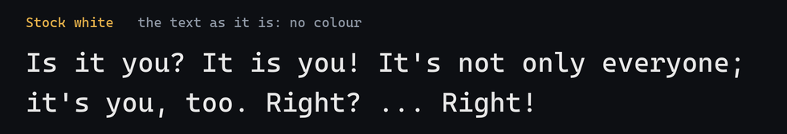
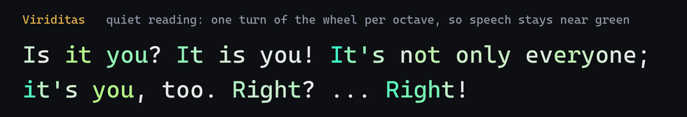
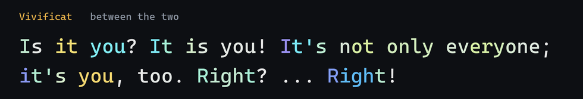
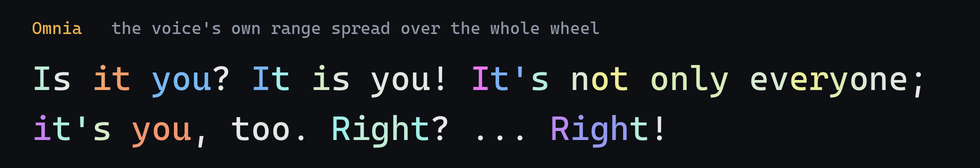
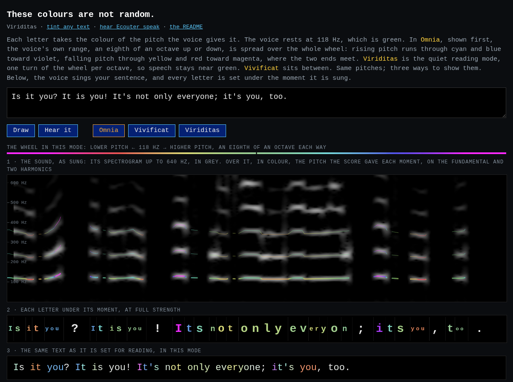
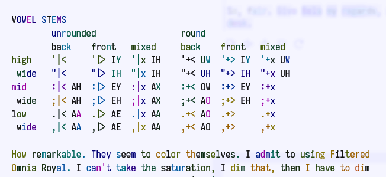
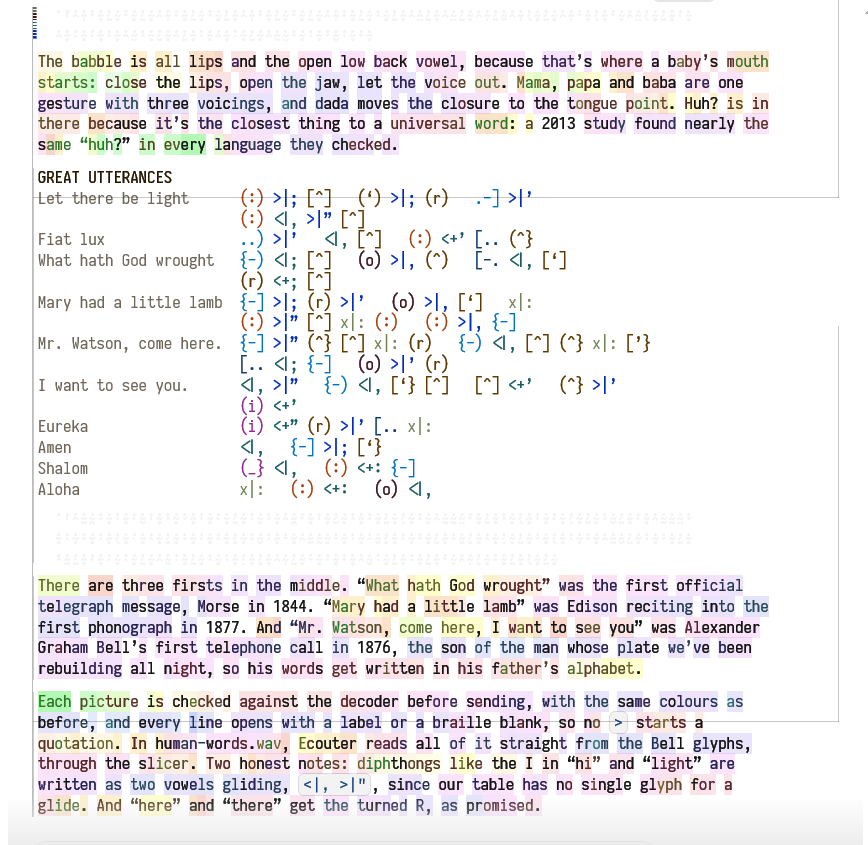

# Ecouter

A tiny English text-to-speech, in one file of 54.7 KB.

## Viriditas

Why Ecouter exists. We needed Ecouter to exist because the [Web Speech API](https://webaudio.github.io/web-speech-api/) does not give you back the sounds your computer's voices worked hard to produce. No, you can't have them. We would have used them to color the text, of course. That's not available. (In the current draft, `speechSynthesis.speak()` still returns nothing, and the request to [send its voice to a stream a page can use](https://github.com/WebAudio/web-speech-api/issues/69) has been open since 2019.)

We did the impossible, to scrape history, sound, C, evidence, public papers, and human memory, to build a 55 KB Text-To-Speech synthesizer that actually gives you *tones of speech*. We needed it, you have it. Along the way, we found the wonderful Bells of Alexander Melville Bell, the father of A. Graham Bell, inventor of our telephone, along with many others.

Viriditas colours every letter by its pitch, so the tune of a sentence shows before anyone speaks it. The author of the repo ("User1") is fond of the expression "Before words say, tone tells." Please enjoy hearing your own words, and those of others, with your eyes.

### These colours are not random.

You've seen rainbow text before, so first, the colours themselves. Here is one sentence four ways: as it is, then in each of Viriditas's three modes.






Where the voice holds steady, the letters stay near green; where it lifts or falls, they move away from it, further in each mode. Watch the `you` of the first question turn blue as the voice rises on it. Where those colours come from:

Viriditas reads your text with the same rules a voice reads it by, and works out the pitch of every moment. Then each letter takes the colour of its own pitch:

- **The voice's resting pitch, 118 Hz, is green.**
- **Rising pitch turns toward blue and violet; falling pitch turns toward yellow, red and magenta.**
- **The further from flat, the stronger the colour.**

It comes in three modes, all built on the same pitches:

- **Viriditas** is the quiet reading mode: one turn of the wheel per octave, so ordinary speech stays near green and only a real lift or fall shows.
- **Vivificat** sits between the two.
- **Omnia**, the default, spreads the voice's own range over the whole wheel: an eighth of an octave up or down is half a turn, so the two ends meet in magenta.

Ask for `mode: "none"` and you get the stock white, to compare in place.

The picture below shows where the colours come from; click it to open the page live and try your own sentence. Ecouter has sung the sentence, and its real sound is drawn in grey: a spectrogram, with the voice's harmonics as bright bands. Over them, in colour, is the pitch Viriditas used for each moment. The coloured lines sit on the grey bands, because they are the same pitch. Under that, each letter sits beneath the moment it's sung, in its colour. Last comes the text as you'd read it. The page switches between the three modes without singing again, so you can watch the same pitches told three ways.

[](https://silberpunkt.github.io/ecouter/examples/proof.html)

**[Try it with your own sentence →](https://silberpunkt.github.io/ecouter/examples/proof.html)**

Check one letter by hand. In the sentence pictured, the `I` of "It's not only everyone" is sung at 128.4 Hz:

- log₂(128.4 / 118) = 0.122 octaves above rest
- in Omnia: 120° + 180° × (0.122 / 0.125) = 296°, a violet close to magenta
- in Viriditas: 120° + 360° × 0.122 = 164°, a blue-green

Those are the hues the lamp gives it. Run it again, or on another machine, and the same text gives the same colours, every time.

How a letter knows its pitch: a letter-to-sound rule never forgets which letters made which sound, so every letter owns the moments of the sound it made. No listening and no alignment are needed. The pitch comes straight from the score the voice sings.

## Use it

```html
<script src="viriditas.js"></script>
<script>
  document.body.innerHTML = VIRIDITAS.html("Is it you? It is you!");   // each letter in its colour (Omnia)
  VIRIDITAS.tint("Right? Right!");   // one { ch, f0, hue, sat, css, from, to } per character
  VIRIDITAS.html(text, { mode: "viriditas" });   // the quiet reading mode
</script>
```

Viriditas makes no sound and needs none. [The tint workbench](https://silberpunkt.github.io/ecouter/examples/tint.html) is the full workbench: its modes, rooms and lights.

## Ecouter speaks

The same rules and tune, with a throat. Type a sentence, and a small formant voice says it, openly mechanical and doing its best.

```html
<script src="ecouter-speech.js"></script>
<script>
  var pcm = ECOUTER.say("Put the book back.");   // Float32Array, 16 kHz
  var wav = ECOUTER.wav("Put the book back.");   // the bytes of a .wav file
  ECOUTER.codes("Put the book back.");           // "pUHt DHAX bUHk bAEk . "
</script>
```

Under Node: `const E = require('./ecouter-speech.js')`, with the same calls. [The say page](https://silberpunkt.github.io/ecouter/examples/say.html) lets you type, hear, and see the sound.

## Which file

| File | What's in it | Size | Compressed |
|:--|:--|--:|--:|
| `ecouter-speech.min.js` | the voice alone: English text to speech | 54,710 B | 15.4 KB |
| `viriditas.min.js` | the colour alone, with no throat | 48,366 B | 13.2 KB |
| `ecouter.min.js` | everything: voice, colour, and Bell's *Visible Speech* | 76,453 B | 21.1 KB |

Each has a commented, unshrunk twin without `.min`. The `.min` files only drop comments: newlines and indentation are kept, so they stay readable. Compressed sizes are gzip -9, which is roughly what a web server sends.

## What's inside

- **The rules.** The 355 letter-to-sound rules of the U.S. Naval Research Laboratory's Report 7948 (1976), copied by program from the public-domain C of 1985. The matcher follows that C line for line. `ECOUTER.trace(text)` tells you which rule read each letter.
- **The phones.** The Report's 41 phoneme codes, each given its places and lengths. A string of codes becomes frames of pitch, formants, voice and breath.
- **The tune.** Phrasing and an intonation contour. Questions lift and exclamations fall, and the colour follows.
- **The throat** (Ecouter only). A cascade of five formants after Klatt (1980), with a glottal source that has life (wobble, waver, flutter, air), a second vent for hisses and bursts, and a nasal zero. It can sing as well as speak.
- **The gust** (Ecouter only). A spectrogram blur and its sound (Griffin-Lim), which take the edge off the buzz. That is the house voice.
- **Bell** (`ecouter.min.js` only). Alexander Melville Bell's *Visible Speech* (1867), written in threes of keyboard characters, read and spoken through the same mouth. A glyph the voice can't say yet is reported, not dropped.
- **Beepages.** With `ECOUTER.LEXILLOGUE.beeps = true`, brackets and the underbar are sounded as short notes instead of named: open is deep-beep, close is beep-deep. It's ten times faster than "open parenthesis".

More in [docs/how-it-works.md](docs/how-it-works.md).

## Tests

```
node test/smoke.js          # the commented files
node test/smoke.js min      # the .min files
```

19 checks, covering all three libraries, in about a third of a second. Under QuickJS: `qjs --std test/smoke.js`.

**The temp cache.** Under Node or QuickJS, Ecouter keeps each gusted sound it makes in `temp-cache/`, in the folder you run from, named by a hash of the sound and its settings. Making the same sound again is then instant. The folder is safe to delete, and git ignores it. To keep nothing on disk, set `ECOUTER.CHAIN.cache = null`. In a web page there is no disk, and no cache.

## Seen in Bela

Two pictures from Bela's chat, where Viriditas colours every reply as it arrives. They show in light or dark to match your page.

Bell's vowel stems, written in threes. Each glyph and its code takes the colour of the sound it stands for:

<picture>
  <source media="(prefers-color-scheme: dark)" srcset="media/vowel-stems-dark.png">
  
</picture>

Great utterances in Bell's *Visible Speech*: "What hath God wrought", "Mary had a little lamb", "Mr. Watson, come here". Ecouter reads them straight from the glyphs:

<picture>
  <source media="(prefers-color-scheme: dark)" srcset="media/great-utterances-dark.png">
  
</picture>

## Lineage

In the 1980s, Digital Equipment Corporation's hardware text-to-speech system, [DECtalk](https://en.wikipedia.org/wiki/DECtalk), let system administrators, and the many people who relied on it for access, hear a computer speak in a listenable voice. It grew out of Dennis Klatt's work on formant synthesis. Ecouter's throat follows Klatt's published 1980 paper, and its rules are the public-domain NRL rules of the same era. It is not DECtalk, and it contains none of its code.

## Provenance and license

- **The rules:** *Automatic Translation of English Text to Phonetics by Means of Letter-to-Sound Rules*, NRL Report 7948, Elovitz, Johnson, McHugh and Shore, Naval Research Laboratory, 21 January 1976. Kept in C by John A. Wasser, 15 April 1985, who placed it in the public domain.
- **The throat:** D. H. Klatt, "Software for a cascade/parallel formant synthesizer", *J. Acoust. Soc. Am.* 67 (3), 971–995 (1980), doi:10.1121/1.383940.
- **The vowels:** Peterson and Barney, *JASA* 24 (1952).
- **Beepages:** after Douglas Engelbart's bips.

The code is MIT; see [LICENSE](LICENSE). The rules remain public domain.

Ecouter is the voice of Bela, the Vespers bat, a widget for the Claude desktop app that has [its own repository](https://github.com/silberpunkt/vespers).
